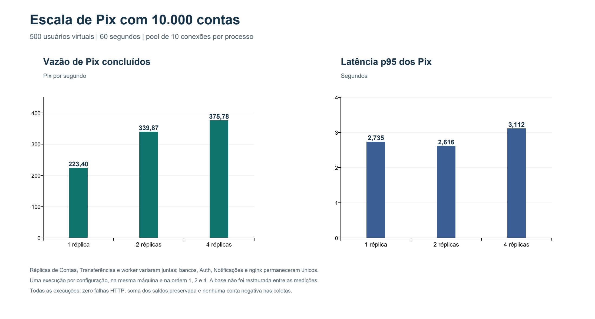

# Medição de escala

## Configuração
- Ambiente local isolado: `pixplus-etapa3`.
- k6 v2.3.0, 500 usuários virtuais, 60 segundos e pausa de 100 ms entre operações.
- Mesmo lote de 10000 contas nas três medições, com depósito inicial de 10000 centavos por conta.
- Origem e destino escolhidos aleatoriamente no lote; valores de 1 a 100 centavos.
- Tokens obtidos antes da carga; duas consultas de preparação não entram na métrica de Pix.
- Contas, Transferências e worker variaram juntos: 1, 2 e 4 réplicas de cada serviço.
- `DB_POOL_MAX=10` por processo. A capacidade agregada dos pools aumenta com as réplicas.
- Auth, Notificações, nginx e cada banco permaneceram com uma instância.
- Coletas realizadas em 26/11/2026 UTC, correspondentes a 25/11/2026 no horário de Brasília.

## Resultados observados

| Réplicas por serviço | Pix concluídos | Pix/s | p95 (s) | Falhas HTTP dos Pix | Soma antes → depois (centavos) | Negativas antes → depois |
| --- | ---: | ---: | ---: | ---: | --- | --- |
| 1 | 13826 | 223,40 | 2,735 | 0,00% | 100460000 → 100460000 | 0 → 0 |
| 2 | 21002 | 339,87 | 2,616 | 0,00% | 100460000 → 100460000 | 0 → 0 |
| 4 | 22922 | 375,78 | 3,112 | 0,00% | 100460000 → 100460000 | 0 → 0 |

A vazão observada aumentou 52,1% com duas réplicas e 68,2% com quatro, em relação a uma.
O crescimento não foi linear. Quatro réplicas deram a maior vazão, mas o p95 foi maior que nas outras duas configurações.
As três execuções tiveram zero verificações reprovadas, recusas por saldo insuficiente e respostas inesperadas.

## Auditoria dos lançamentos
Uma consulta manual ao banco de Contas auditou as 57750 transferências do lote das três execuções.
Nenhuma apresentou quantidade diferente de um débito e um crédito.
O total coincide com a soma dos Pix concluídos informados pelo k6.

Resultado da consulta em `resultados-escala/auditoria-lancamentos.json`.
Consulta reproduzível em `auditar-lancamentos-escala.sql`, com parâmetro psql `lote=1795660214472`.

## Limites da comparação
- Uma execução por configuração; não foram calculados intervalos de confiança.
- Ordem fixa: 1, 2 e 4 réplicas, na mesma máquina que executou o gerador de carga.
- A base foi reutilizada, sem restauração de saldos, lançamentos e tabelas de eventos entre as execuções.
- O estado da fila no início de cada configuração não está documentado nos arquivos de evidência desta entrega.
- Resultados das consultas SQL em `auditoria.json`.
- A taxa é a fornecida pelo contador do k6, incluindo o período de finalização da execução.
- A auditoria dos lançamentos verifica as quantidades por transferência no lote. A repetição de uma chave e o Pix cruzado foram validados separadamente na etapa 3.
- O teste de queda de uma réplica durante a carga ainda não está incluído.

## Evidências e reprodução do gráfico
- Resumos originais: `resultados-escala/escala-1.json`, `escala-2.json` e `escala-4.json`.
- Coletas: `resultados-saldos-escala-{1,2,4}-{antes,depois}.json`.
- Tabela numérica: `resultados-escala/resumo.csv`.
- Gráficos: `resultados-escala/grafico-escala.png` e `.svg`.
- Logs completos `execucao-{1,2,4}.log` mantidos localmente.
- Gerador: `python carga/gerar-grafico-escala.py` (requer `reportlab` e `pypdfium2`).
- Dados do seed e tokens permanecem locais e ignorados pelo Git.
