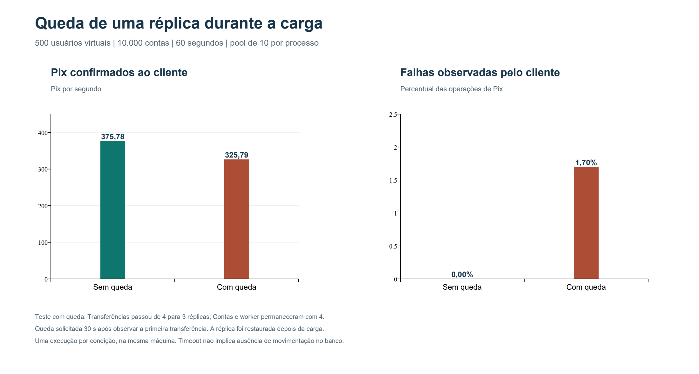

# Queda de uma réplica durante a carga

## Procedimento
- Execução em 26/11/2026, horário de Brasília; horários técnicos preservados em UTC.
- Projeto isolado `pixplus-etapa3`, revisão `5606845536904e3f3a84492962d467eda70da27a`.
- k6 v2.3.0, 500 usuários virtuais, 10000 contas e 60 segundos de carga configurada.
- Mesmo `escala.js` e lote da medição de escala; valores de 1 a 100 centavos, pausa de 100 ms e sem reenvio automático pelo cliente.
- Quatro réplicas iniciais de Contas, Transferências e worker, pool de 10 por processo.
- Alvo: `pixplus-etapa3-transferencias-4`. O script valida projeto, serviço e identificador antes de agir.
- O script observa a primeira nova transferência do lote e aguarda 30 segundos para solicitar `SIGKILL`.
- Somente Transferências passou de quatro para três réplicas. Bancos, Auth, Notificações e nginx permaneceram únicos.

## Cronologia UTC
- Comando de carga iniciado: `2026-11-26T03:14:20.0292442Z`.
- Primeira transferência observada: `2026-11-26T03:14:22.9387356Z`.
- Container finalizado: `2026-11-26T03:14:53.440284751Z`, código 137.
- Comando de carga finalizado: `2026-11-26T03:15:28.7243981Z`.
- Restauração saudável verificada: `2026-11-26T03:15:35.7336217Z`.
- A réplica foi religada no bloco `finally`.

## Resultado observado pelo cliente

| Condição | Operações de Pix | Confirmações de sucesso | Pix confirmados/s | p95 (s) | Falhas | Taxa de falha |
| --- | ---: | ---: | ---: | ---: | ---: | ---: |
| Sem queda | 22922 | 22922 | 375,78 | 3,112 | 0 | 0,00% |
| Com queda | 21813 | 21443 | 325,79 | 2,499 | 370 | 1,70% |

O serviço continuou atendendo, com degradação: 1,70% das operações falharam na perspectiva do cliente.
O código de saída do k6 foi 99, pois os thresholds herdados do cenário exigem zero falhas.
Isso não equivale a erro de execução do controlador, nem a validação de disponibilidade sem falhas.
O log contém 279 linhas de aviso de timeout. Não há discriminação completa dos demais erros no resumo agregado.

## Reconciliação e integridade
- Banco: 21486 transferências concluídas do lote desde o início do comando.
- 10034 foram criadas e marcadas como concluídas entre a queda e o fim da carga, antes da restauração.
- Há 43 conclusões adicionais no banco em relação às confirmações do cliente.
- Não foi registrada correlação individual entre cada resposta perdida e sua chave; não é possível atribuir nominalmente essas conclusões aos timeouts.
- A auditoria dos 21486 identificadores encontrou zero transferências com quantidade diferente de um débito e um crédito.
- Soma antes e depois: 100460000 centavos; nenhuma conta negativa nas duas coletas.
- Resultados SQL transcritos da saída fornecida pelo usuário em `auditoria.json`.

## Limitações
- Uma execução por condição, em ambiente local com gerador e serviços na mesma máquina.
- Base reutilizada após as três medições de escala, sem restauração dos dados.
- A comparação de vazão e p95 é descritiva; não isola o efeito da queda nem garante escala ou disponibilidade em produção.
- A taxa de falha é global para toda a execução, não apenas para o intervalo com três réplicas.
- O p95 inclui falhas; um p95 menor com queda não demonstra melhoria de experiência ou confiabilidade.
- As consultas de auditoria usam o lote e o início temporal do teste; não executar outra carga com esse lote antes de repetir a auditoria.
- O teste não valida uma indisponibilidade longa nem queda do banco.

## Evidências e reprodução
- Controlador: `testar-queda-replica.ps1`.
- Consultas: `auditar-queda-replica-transferencias.sql` e `auditar-queda-replica-lancamentos.sql`.
- Pasta: `resultados-queda-replica/execucao-1/`, com metadados, resumo k6, saldos, auditoria, CSV e gráficos PNG/SVG.
- `execucao.log` permanece local e ignorado pelo Git.
- Para gerar novamente relatório e gráfico: `python carga/gerar-relatorio-queda-replica.py`, com `reportlab` e `pypdfium2`.
- O controlador recusa sobrescrever uma execução existente. Os tokens e senhas do seed permanecem locais e ignorados pelo Git.
